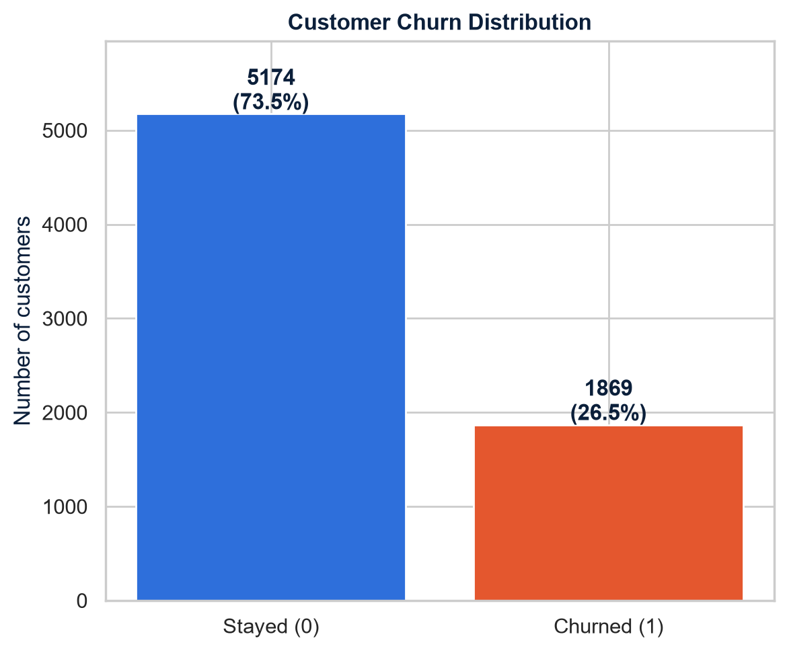
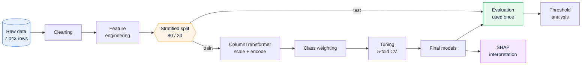
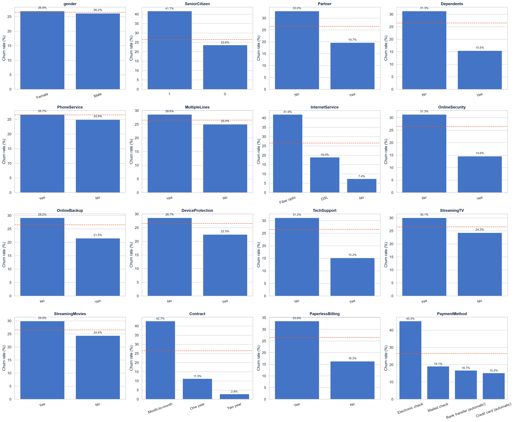
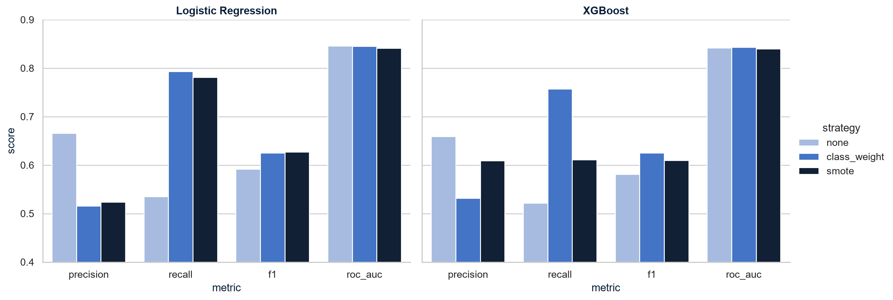
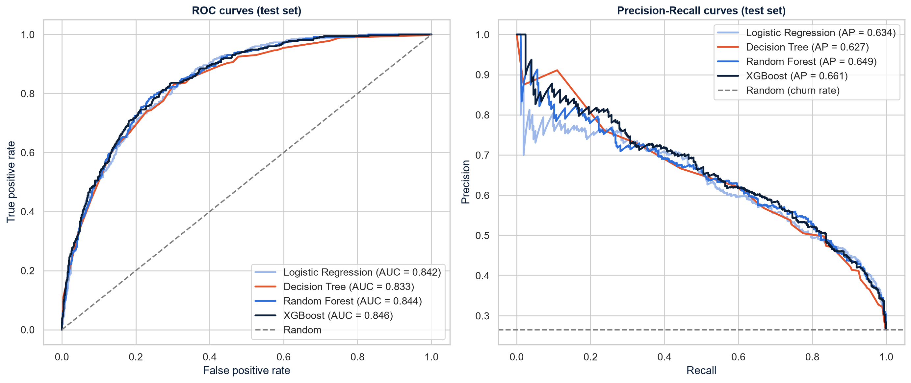
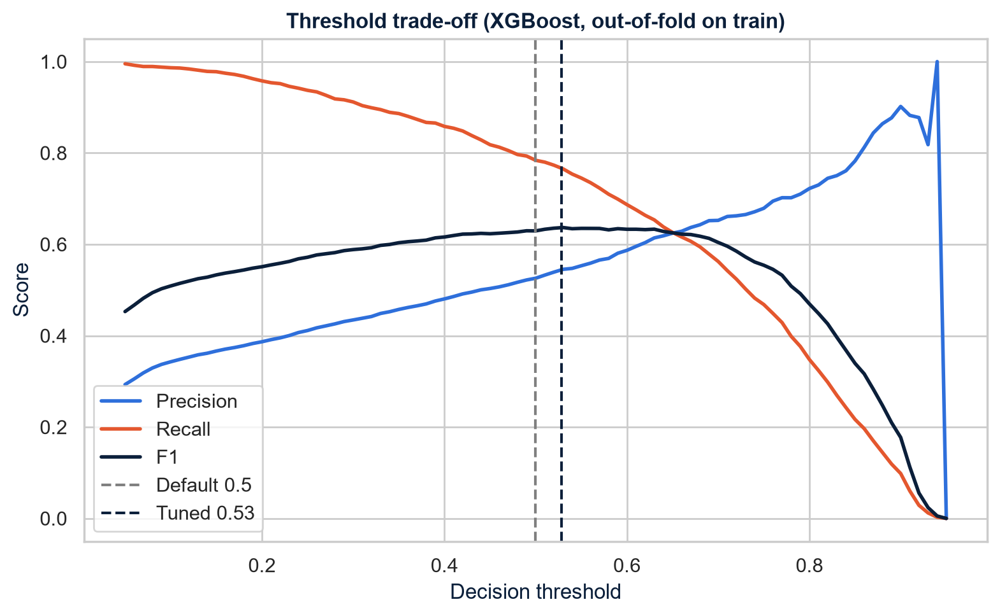
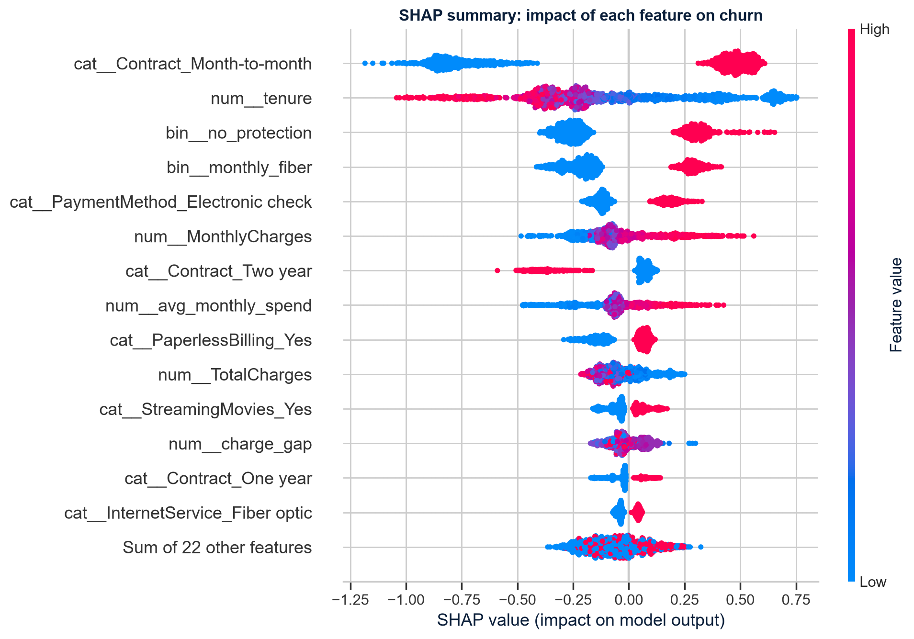
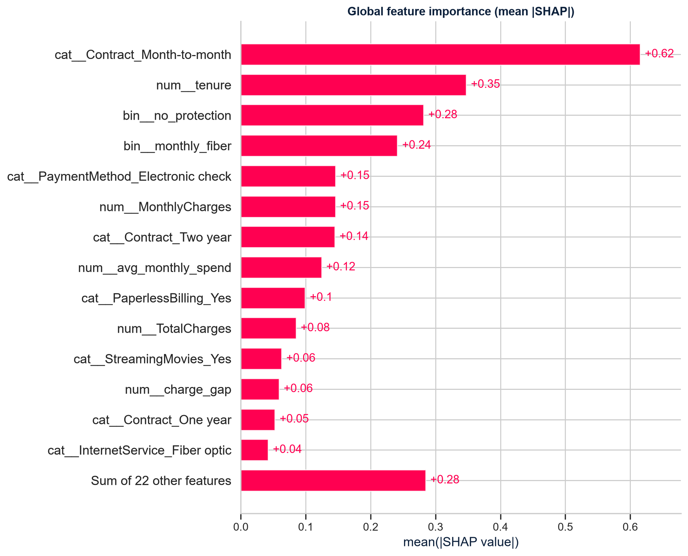

<div align="center">


**End-to-end ML project that predicts which telecom customers are likely to leave.**
EDA · feature engineering · class imbalance · four tuned models · threshold analysis · SHAP


[Problem](#problem-and-objective) · [Dataset](#dataset) · [Methodology](#methodology) · [Results](#results) · [SHAP](#model-interpretation-shap) · [Recommendations](#business-recommendations) · [Run it](#how-to-run)

</div>

---

## At a glance

| Customers | Churn rate | Models | Best test ROC-AUC | Explainability |
|:---:|:---:|:---:|:---:|:---:|
| **7,043** | **26.5%** | **4** tuned | **0.846** (XGBoost) | **SHAP** |

## Problem and objective

Acquiring a new customer costs far more than keeping an existing one. The goal is to **identify customers at risk of leaving** so that retention actions (offers, calls, contract upgrades) can be targeted.

> [!IMPORTANT]
> The two kinds of errors do not cost the same: a missed churner means lost revenue, while a false alarm only costs a retention offer. The project therefore evaluates models with **precision, recall, F1-score and ROC-AUC** rather than accuracy, with an emphasis on **recall**.

## Dataset

[IBM Telco Customer Churn](https://www.kaggle.com/datasets/blastchar/telco-customer-churn) (Kaggle): **7,043 customers and 21 columns** (19 features, a customer ID and the binary target `Churn`).

| Group | Features |
|---|---|
| Demographics | `gender`, `SeniorCitizen`, `Partner`, `Dependents` |
| Account | `tenure`, `Contract`, `PaperlessBilling`, `PaymentMethod`, `MonthlyCharges`, `TotalCharges` |
| Services | `PhoneService`, `MultipleLines`, `InternetService`, `OnlineSecurity`, `OnlineBackup`, `DeviceProtection`, `TechSupport`, `StreamingTV`, `StreamingMovies` |
| Target | `Churn` (26.5% positive, so moderately imbalanced) |

<div align="center">

</div>

## Methodology

### Pipeline overview



### 1. Exploratory data analysis

Target distribution, numeric and categorical drivers of churn, churn rate by tenure bucket, contract × internet service interaction, and correlations.

<div align="center">

</div>

**What stands out**

| Higher churn | Little or no signal |
|---|---|
| Month-to-month contract | `gender` |
| Short tenure (first year) | |
| Fiber optic internet | |
| Electronic check payment | |
| No tech support / online security | |

### 2. Data cleaning

- `TotalCharges` had 11 blank values, all for customers with `tenure = 0` (new customers not yet billed), so they were set to **0** instead of being dropped or imputed.
- `customerID` was removed.
- The redundant categories "No internet service" and "No phone service" were merged into "No".
- Duplicate profiles were kept: many different customers legitimately share the same profile.

### 3. Feature engineering

| Feature | Idea |
|---|---|
| `n_addons` | Number of add-on services (more services, more attached customer) |
| `avg_monthly_spend` | Historical spend per month vs the current bill |
| `charge_gap` | Whether the customer pays more now than on average in the past |
| `tenure_group` | Non-linear lifecycle stage (0-12, 13-24, 25-48, 49-72 months) |
| `is_autopay` | Automatic payment method (lower friction) |
| `no_protection` | Internet customer with neither security nor tech support |
| `monthly_fiber` | Interaction of the two strongest signals: month-to-month contract and fiber |

### 4. Split and preprocessing

Stratified 80/20 train/test split (`random_state=42`). Scaling (`StandardScaler`) and encoding (`OneHotEncoder`) live in a `ColumnTransformer` fitted on **training data only**, inside a scikit-learn `Pipeline`. All reusable logic is in `src/preprocessing.py`.

### 5. Class imbalance

Three strategies were compared with 5-fold stratified cross-validation on Logistic Regression and XGBoost, with resampling applied inside each training fold only.

| Model | Strategy | Precision | Recall | F1 | ROC-AUC |
|---|---|:---:|:---:|:---:|:---:|
| Logistic Regression | none | 0.666 | 0.535 | 0.592 | 0.846 |
| | **class_weight** (retained) | 0.516 | 0.793 | 0.625 | 0.845 |
| | SMOTE | 0.524 | 0.781 | 0.627 | 0.841 |
| XGBoost | none | 0.659 | 0.522 | 0.581 | 0.842 |
| | **class_weight** (retained) | 0.532 | 0.757 | 0.625 | 0.843 |
| | SMOTE | 0.609 | 0.611 | 0.610 | 0.840 |

ROC-AUC does not move, because rebalancing mostly shifts the decision threshold rather than the ranking. Class weighting raises recall from about 0.53 to 0.76-0.79 at the cost of precision.

> [!NOTE]
> **`class_weight` was retained**: it matches SMOTE for Logistic Regression, clearly beats it for XGBoost, is simpler, and creates no synthetic data.

<div align="center">

</div>

### 6. Models and hyperparameter tuning

Logistic Regression, Decision Tree, Random Forest and XGBoost, all with class weighting. Baselines were compared with 5-fold CV, then tuned with `GridSearchCV` (Logistic Regression, Decision Tree) or `RandomizedSearchCV` (Random Forest, XGBoost), optimizing ROC-AUC.

| Model | CV ROC-AUC before | CV ROC-AUC after | Selected hyperparameters |
|---|:---:|:---:|---|
| Logistic Regression | 0.845 | 0.846 | `C=10` |
| Decision Tree | 0.642 | **0.826** | `max_depth=5`, `min_samples_leaf=10`, `criterion=gini` |
| Random Forest | 0.832 | 0.848 | 200 trees, `max_depth=8`, `min_samples_leaf=5`, `max_features=sqrt` |
| XGBoost | 0.843 | 0.848 | 400 trees, `max_depth=4`, `learning_rate=0.01`, `subsample=0.7`, `colsample_bytree=0.85` |

The untuned Decision Tree memorized the training data (train ROC-AUC of 1.0 against 0.642 in validation), so limiting depth gave the largest gain. After tuning, Random Forest, XGBoost and Logistic Regression are tied within the fold-to-fold variation (standard deviation of about 0.011).

### 7. Evaluation

Final models were evaluated **once** on the held-out test set. Model comparison and tuning relied on cross-validation only.

## Results

Test set (1,409 customers), default threshold 0.5:

| Model | Precision | Recall | F1 | ROC-AUC | PR-AUC |
|---|:---:|:---:|:---:|:---:|:---:|
| Logistic Regression | 0.506 | 0.789 | 0.617 | 0.842 | 0.634 |
| Decision Tree | 0.528 | 0.743 | 0.617 | 0.833 | 0.627 |
| Random Forest | 0.539 | 0.789 | **0.641** | 0.844 | 0.649 |
| XGBoost | 0.526 | 0.789 | 0.631 | **0.846** | **0.661** |

<div align="center">

</div>

<details>
<summary><b>Reading the results</b> (click to expand)</summary>

<br>

- The four models perform very similarly (test ROC-AUC between 0.833 and 0.846). The differences are of the same order as the fold-to-fold variation observed in cross-validation, so none of them is clearly better at ranking customers.
- Tuning mattered most for the Decision Tree: cross-validated ROC-AUC rose from 0.642 to 0.826 (0.833 on the test set) once depth and leaf size were limited.
- A simple, transparent Logistic Regression is competitive with the ensembles, which suggests that most of the signal in this dataset is close to linear (contract, tenure, charges).
- Random Forest has the best F1 (0.641), XGBoost the best ROC-AUC (0.846) and PR-AUC (0.661, against a random baseline of about 0.27). XGBoost was used for the SHAP analysis, a choice made before looking at the results because it supports fast and exact explanations.

</details>

### Threshold analysis

<div align="center">

</div>

The F1 curve is flat between thresholds of about 0.4 and 0.65, and the F1-optimal threshold found on out-of-fold training predictions (0.53) is very close to the default. On the test set it does not improve F1, so the default of 0.5 is kept.

| XGBoost, test set | Threshold | Precision | Recall | F1 |
|---|:---:|:---:|:---:|:---:|
| Default | 0.500 | 0.526 | 0.789 | 0.631 |
| Tuned on training data | 0.528 | 0.533 | 0.765 | 0.628 |

> [!TIP]
> Because F1 is so flat, the threshold is best treated as a **business lever**: lowering it trades precision for recall according to the cost of a missed churner and the capacity of the retention team.

## Model interpretation (SHAP)

SHAP assigns each feature a contribution to each individual prediction (in log-odds for XGBoost), relative to the model's average prediction. **Positive values push toward churn.**

<table>
<tr>
<td align="center" width="50%"><b>Summary (beeswarm)</b><br></td>
<td align="center" width="50%"><b>Feature importance</b><br></td>
</tr>
</table>

**Main drivers of churn**

1. `TODO` Feature 1, with direction and a plain-language reading
2. `TODO` Feature 2
3. `TODO` Feature 3
4. `TODO` Feature 4
5. `TODO` Feature 5

**Consistency with the EDA.** `TODO` Which exploratory findings the model confirms, and where SHAP adds nuance.

**Engineered features.** `TODO` Whether `monthly_fiber`, `no_protection`, `n_addons` or others rank among the top features, stated honestly either way.

**Individual explanations.** The waterfall plots in `results/` explain one high-risk and one low-risk customer: `TODO` one sentence on what drives each.

**Cross-check.** Logistic Regression coefficients ([`results/17_lr_coefficients.png`](results/17_lr_coefficients.png)) `TODO agree / partly agree` with the SHAP ranking.

> [!WARNING]
> Some engineered features are exact combinations of others (`n_addons` is the sum of six service columns, and `charge_gap` is `MonthlyCharges` minus `avg_monthly_spend`), so their individual coefficients and SHAP values should be read together with the features they derive from.

## Business recommendations

| # | Action | Why |
|:---:|---|---|
| 1 | **Move month-to-month customers to longer contracts** with incentives | Contract type is among the strongest churn signals |
| 2 | **Invest in the first-year experience** (onboarding, early check-ins) | Churn is concentrated in the first months |
| 3 | **Bundle tech support and online security** for internet customers | They churn more without them |
| 4 | **Encourage automatic payment** over electronic check | Electronic check is linked to higher churn |
| 5 | **Review the fiber offer** (price and quality) | Fiber is associated with higher churn |
| 6 | **Use the model as a ranking tool** | Contact customers from the highest predicted risk downward until the retention budget is used |

> [!CAUTION]
> These recommendations rely on associations found by the model and should be validated with experiments (for example A/B tests of retention offers) before being treated as causal.

## Design decisions

<details>
<summary><b>Click to see the safeguards against leakage and bias</b></summary>

<br>

- **No data leakage:** the split happens before any fitting, and scaler, encoder and models learn from training data only. Cleaning and feature functions are row-wise and cannot leak.
- **Resampling inside cross-validation:** SMOTE, when tested, was applied within each training fold, never before the split.
- **Model comparison and tuning on cross-validation;** the test set was used once for the final report.
- **Tuning on ROC-AUC, threshold analyzed separately:** this separates ranking quality from the precision/recall trade-off.
- **Threshold chosen on out-of-fold training predictions,** so the test estimate stays unbiased.
- **Reproducibility:** fixed random seeds, pinned dependencies, and reusable logic in `src/preprocessing.py`.

</details>

## Limitations and future work

| Limitations | Future work |
|---|---|
| Single dataset with no time dimension: predicts *whether* a customer churns, not *when* | Survival analysis |
| No cost data: assumes missed churners cost more than false alarms | Cost-sensitive thresholding with real cost figures |
| SHAP explains model behavior, not causal effects | A/B tests of retention offers |
| SMOTE tested on one-hot features creates fractional values | `SMOTENC` for categorical variables |
| Several models are statistically tied, so the choice rests on interpretability | LightGBM, CatBoost, probability calibration |
| | Deployment as an API (FastAPI) or Streamlit app |

## Project structure

```
customer-churn-prediction/
├── data/
│   └── WA_Fn-UseC_-Telco-Customer-Churn.csv
├── notebooks/
│   └── customer_churn_analysis.ipynb   # full analysis, from EDA to SHAP
├── src/
│   └── preprocessing.py                # cleaning, feature engineering, preprocessing pipeline
├── results/                            # figures, metric tables, saved models
├── requirements.txt
└── README.md
```

## How to run

```bash
git clone https://github.com/SouMej/customor-churn-prediction.git
cd customor-churn-prediction

python -m venv .venv
# Windows (PowerShell)
.\.venv\Scripts\Activate.ps1
# macOS / Linux
source .venv/bin/activate

pip install -r requirements.txt
jupyter notebook notebooks/customer_churn_analysis.ipynb
```

Run the notebook from top to bottom. Figures and tables are written to `results/`. Trained pipelines are saved as `.joblib` files and can be reloaded with:

```python
import joblib
model = joblib.load("results/model_xgboost.joblib")
model.predict_proba(new_customers)[:, 1]   # new_customers must go through add_features first
```

---

<div align="center">

**Sonia Mejri** · Engineering student (ICT Networks and Telecommunications) · INSAT


</div>